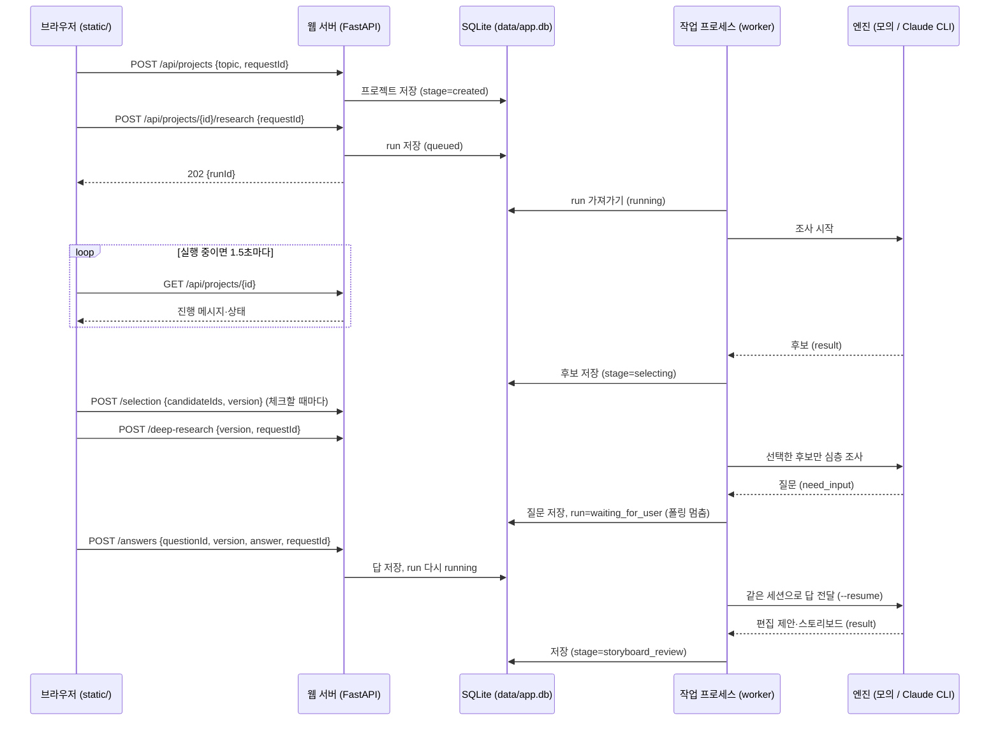

# API 명세 (v0.2)

> 상태: v0.1을 사용자가 승인했고(2026-10-23), 구현하면서 바뀐 점과 연결 방식(3.1)을 더했어요.
> 근거: PRD.md "웹 API 계약 초안"과 "실행 구조", DECISIONS.md D1~D9.
> PRD 표에 없는데 새로 넣은 것에는 **[추가]**, AI가 임의로 정한 기본값에는 **[AI 기본안]**을 붙였어요.

## 0. 공통 규칙

- 서버: FastAPI, 기본 주소 `http://127.0.0.1:8765`. `0.0.0.0`에는 바인딩하지 않아요. 포트가 사용 중이면 실행할 때 멈추고 `--port`로 다른 포트를 쓰라고 안내해요.
- 요청·응답은 모두 JSON(UTF-8)이에요. 시각은 ISO 8601에 타임존을 붙여요(예: `2026-10-23T12:20:00+09:00`).
- ID는 접두사가 붙은 무작위 문자열이에요: `prj_`, `run_`, `cand_`, `q_`, `card_`. **[AI 기본안]**
- 인증은 없어요. 127.0.0.1 전용 로컬 앱이라서예요. 엔진·agy 인증값은 앱이 읽지도 저장하지도 않아요.

### 0.1 오래 걸리는 작업

변경 요청은 오래 걸리는 작업을 **바로 끝내지 않아요.** 작업(run)을 만들고 즉시 `202 Accepted`와 `runId`를 돌려줘요. 화면은 `GET /api/projects/{id}`를 폴링해서 진행 상황을 봐요(실행 중일 때 1.5초 간격 **[AI 기본안]**). SSE는 쓰지 않아요(D6).

### 0.2 requestId (중복 방지)

변경을 일으키는 요청(아래 표에서 "requestId 필수")은 `requestId`를 받아요.

- 화면이 **사용자 행동 하나에 UUID 하나**를 만들어요. 같은 버튼을 다시 누르거나 네트워크 재시도를 해도 같은 ID를 보내요.
- 서버는 `(projectId, requestId)`를 키로 `엔드포인트 + 정규화한 요청 본문의 해시`와 **처음 돌려준 응답(상태 코드 포함)**을 저장해요.
  - 같은 ID + 같은 입력 → 저장한 응답을 그대로 돌려줘요. 작업을 새로 만들지 않아요.
  - 같은 ID + 다른 입력 → `409 IDEMPOTENCY_CONFLICT`.
- 이미 같은 종류의 작업이 실행 중이면 requestId가 달라도 새 작업을 만들지 않고 `409 RUN_IN_PROGRESS`와 실행 중인 `runId`를 돌려줘요.
- 저장 기간: 프로젝트가 있는 동안 계속 보관해요. **[AI 기본안]**

### 0.3 version (오래된 화면 방지)

| 대상 | 버전 필드 | 올라가는 시점 |
|---|---|---|
| 후보 선택 | `project.version` | 프로젝트 상태가 바뀔 때마다 1씩 |
| 질문 | `question.version` | 같은 질문을 다시 낼 때(예: 재조사 후) |
| 스토리보드 | `storyboard.version` | 스토리보드를 새로 만들거나 고칠 때 |
| 제작 결과 | `result.version` | 카드를 하나라도 다시 만들 때 |

요청에 보낸 버전이 현재 버전과 다르면 `409 VERSION_CONFLICT`를 돌려주고 현재 버전을 `details.currentVersion`에 넣어요. 화면은 최신 상태를 다시 불러와 "다른 곳에서 바뀌었어요"라고 알려요.

### 0.4 오류 응답

```json
{
  "error": {
    "code": "SEARCH_FAILED",
    "message": "검색 도구 호출이 실패했어요.",
    "nextActions": ["retry"],
    "details": { "runId": "run_...", "engineMessage": "..." }
  }
}
```

| code | HTTP | 뜻 | 화면이 보여 줄 다음 행동 (`nextActions`) |
|---|---|---|---|
| `VALIDATION_ERROR` | 422 | 입력 형식이 틀렸어요(예: 후보 4개 선택) | 입력 고치기 |
| `NOT_FOUND` | 404 | 프로젝트·작업·파일이 없어요 | 목록으로 |
| `STAGE_CONFLICT` | 409 | 지금 단계에서 할 수 없는 요청이에요(예: 선택 전 제작) | 새로고침 |
| `VERSION_CONFLICT` | 409 | 화면이 오래됐어요 | 새로고침 |
| `IDEMPOTENCY_CONFLICT` | 409 | 같은 requestId에 다른 입력이 왔어요 | 새로고침 |
| `RUN_IN_PROGRESS` | 409 | 같은 종류의 작업이 이미 돌고 있어요 | 기다리기 / 취소 |
| `QUESTION_STALE` | 409 | 이미 지나간 질문(다른 ID·버전)에 대한 답이에요 | 새로고침 |
| `ALREADY_ANSWERED` | 409 | 이 질문에는 이미 다른 답이 반영됐어요 | 새로고침 |
| `AUTH_REQUIRED` | 503 | Claude CLI 또는 agy 로그인이 필요해요 | 터미널에서 로그인 후 재시도 |
| `TOOL_UNAVAILABLE` | 503 | `claude`·`agy`가 설치돼 있지 않거나 실행이 안 돼요 | 설치 안내 보기 |
| `SEARCH_FAILED` | 502 | 검색 도구가 실패했거나 결과가 없어요 | 재시도 |
| `ENGINE_OUTPUT_INVALID` | 502 | 엔진이 약속한 형식으로 답하지 않았어요 | 재시도 |
| `IMAGE_FAILED` | 502 | 이미지 파일을 찾지 못했거나 형식·크기가 틀렸어요 | 해당 카드 재시도 |
| `RENDER_FAILED` | 500 | 글자 렌더링·PNG 저장이 실패했어요 | 해당 카드 재시도 |
| `CANCELLED` | 409 | 취소된 작업이에요 | 다시 시작 |
| `INTERRUPTED` | 409 | 서버 재시작으로 끊긴 작업이에요 | 이어하기 / 처음부터 다시 |

`AUTH_REQUIRED`·`SEARCH_FAILED`·`IMAGE_FAILED`·`CANCELLED`는 PRD가 구분하라고 한 다섯 가지 중 네 개이고, "잘못된 답변"은 `VALIDATION_ERROR`·`QUESTION_STALE`·`ALREADY_ANSWERED`로 나눴어요.

작업(run) 안에서 난 오류는 HTTP 응답이 아니라 `run.error`에 같은 모양으로 저장해요. 화면은 폴링 결과에서 읽어요.

## 1. 상태 모델

### 1.1 프로젝트 단계 (`project.stage`)

```
created → researching → selecting → deep_researching → editing
        → storyboard_review → producing → reviewing → final_approved
```

| stage | 뜻 | 다음으로 넘어가는 계기 |
|---|---|---|
| `created` | 주제만 저장됨 | `POST /research` |
| `researching` | 넓은 조사 중 | 조사 run 완료 |
| `selecting` | 후보 7~12개를 보여 주고 선택을 기다림 | `POST /deep-research` |
| `deep_researching` | 선택한 후보 원문 확인 중 | run 완료 |
| `editing` | 독자·형식·후킹 판단, 필요하면 질문 | 스토리보드 생성 완료 |
| `storyboard_review` | 스토리보드 승인 대기 | `POST /approve` (storyboard) 또는 변경 요청 |
| `producing` | 카드별 이미지 생성 + 글자 렌더링 | 모든 카드 완료 또는 일부 실패 |
| `reviewing` | 검수, 부분 수정 | `POST /approve` (final) |
| `final_approved` | 최종 승인됨, 내려받기 가능 | 수정 요청 시 `reviewing`으로 돌아가고 승인 해제 |

결과가 부족해서 30일로 넓힐지 물을 때, 그리고 독자를 물을 때는 단계를 바꾸지 않고 **run 상태만 `waiting_for_user`**가 돼요.

### 1.2 작업 상태 (`run.status`)

| status | 뜻 |
|---|---|
| `queued` | 작업 프로세스가 아직 가져가지 않음 |
| `running` | 실행 중 |
| `waiting_for_user` | 질문에 답을 기다림. **실패가 아니에요.** |
| `succeeded` | 완료 |
| `failed` | 오류. `run.error` 참고 |
| `cancelled` | 사용자가 취소함. 하위 프로세스도 정리됨 |
| `interrupted` | 서버가 재시작돼서 끊김. 이어하기 또는 재시도를 선택해야 함 |

run 종류(`run.kind`): `research`, `deep_research`, `storyboard`, `production`, `revision`, `image_retry`, `render`(글자만 다시 올리기, 단계를 바꾸지 않아요), `export`.

## 2. 데이터 모양

### 2.1 Project (`GET /api/projects/{id}` 응답)

```json
{
  "id": "prj_x1",
  "version": 12,
  "topic": "AI 최신소식",
  "stage": "selecting",
  "isMock": false,
  "engine": { "name": "claude-cli", "sessionId": "8f2c..." },
  "research": {
    "requestedAt": "2026-10-23T12:30:00+09:00",
    "period": { "days": 7, "from": "2026-10-16T12:30:00+09:00", "to": "2026-10-23T12:30:00+09:00" },
    "candidates": [ "Candidate ..." ]
  },
  "selection": { "candidateIds": ["cand_3", "cand_7"], "savedAt": "..." },
  "researchNotes": [ "ResearchNote ..." ],
  "editorial": "Editorial | null",
  "storyboard": "Storyboard | null",
  "result": "Result | null",
  "currentQuestion": "Question | null",
  "answers": [ { "questionId": "q_audience", "questionVersion": 1, "answer": { "optionId": "dev" }, "answeredAt": "..." } ],
  "activeRun": "Run | null",
  "lastRun": "Run | null",
  "finalApproval": { "resultVersion": 3, "approvedAt": "..." },
  "exportsReady": false
}
```

- `isMock`: 모의 엔진으로 만든 데이터면 `true`. 화면 맨 위에 "모의 데이터" 띠를 항상 보여 줘요(PRD 구현 순서 2).
- `engine.sessionId`는 이 프로젝트에서만 써요. 엔진을 바꾸면 새 세션을 열고, 저장해 둔 프로젝트 요약을 시작 맥락으로 넘겨요.

### 2.2 Candidate

```json
{
  "id": "cand_3",
  "title": "...",
  "summary": "두세 문장 요약",
  "category": "모델 | 제품 | 연구 | 개발 도구 | 정책 | 기타",
  "publishedAt": "2026-10-21 | null",
  "eventDate": "2026-10-20 | null",
  "dateStatus": "confirmed | published_only | unverified",
  "sources": [
    { "url": "https://...", "name": "기관·매체 이름", "type": "official | paper | press | blog | unknown" }
  ],
  "whyPick": "선택할 가치",
  "uncertainty": "불확실한 점",
  "status": "released | announced | claimed | unknown"
}
```

- 같은 발표를 다룬 기사는 후보 하나로 묶고 `sources`에 함께 넣어요.
- 날짜를 확인하지 못하면 `null`이고 `dateStatus`는 `unverified`. 화면에 "날짜 미확인"을 보여 줘요.
- `status`로 "발표만 됨"(`announced`)과 "출시됨"(`released`), "업체 주장"(`claimed`)을 구분해요.

### 2.3 ResearchNote (심층 조사 기록, 선택한 후보마다 1개)

```json
{
  "candidateId": "cand_3",
  "facts": [ { "text": "...", "sourceUrls": ["..."] } ],
  "limits": ["..."],
  "conflicts": [ { "text": "A는 X라고, B는 Y라고 함", "sourceUrls": ["...", "..."] } ],
  "primarySources": ["공식 발표·논문·문서 URL"],
  "unreachable": [ { "url": "...", "reason": "접근 실패" } ]
}
```

### 2.4 Question

```json
{
  "id": "q_audience",
  "version": 1,
  "runId": "run_5",
  "prompt": "어떤 독자에게 전달할까요?",
  "multiSelect": false,
  "options": [
    { "id": "general", "label": "일반 사용자", "description": "용어 설명을 늘리고 생활 속 쓰임을 중심으로" },
    { "id": "dev", "label": "개발자", "description": "API·도구 변화와 바로 해 볼 일을 중심으로" },
    { "id": "edu", "label": "교육자", "description": "수업에 쓸 수 있는 사례와 주의점을 중심으로" }
  ],
  "allowFreeText": true,
  "recommendedOptionId": "dev",
  "recommendationReason": "선택한 두 소식이 모두 개발 도구 업데이트라서요.",
  "status": "open"
}
```

- 추천 선택지는 **표시만** 해요. 화면에서 미리 체크하지 않고, 사용자가 제출하기 전에는 답으로 보지 않아요.
- 앱이 직접 내는 질문도 같은 모양이에요. 예: 조사 결과가 부족할 때 `q_expand_period`("30일로 넓힐까요?").

### 2.5 Editorial, Storyboard, Result

```json
{
  "editorial": {
    "audience": "개발자", "whyUseful": "...", "format": "핵심 요약형 | 단계 설명형 | 비교형 | ...",
    "hooks": ["후킹 문구 1", "후킹 문구 2", "후킹 문구 3"],
    "decidedBy": "ai_recommendation | user_answer"
  },
  "storyboard": {
    "version": 2,
    "cards": [
      {
        "id": "card_1", "order": 1, "role": "cover | body | summary | next_action",
        "title": "...", "keyLine": "핵심 문장", "sourceUrls": ["..."],
        "imagePlan": { "kind": "generated | stock | none", "prompt": "구도·분위기·색·빈 공간", "textArea": "top | bottom | center" }
      }
    ],
    "approvedAt": null
  },
  "result": {
    "version": 3,
    "cards": [
      {
        "cardId": "card_1", "cardVersion": 2,
        "status": "pending | generating_image | rendering | done | failed",
        "pngUrl": "/api/projects/prj_x1/files/results/cards/card_1.v2.png",
        "layout": { "textArea": "top", "scale": null, "scrim": "auto", "color": "auto", "title": null, "keyLine": null, "body": null, "textEdited": false },
        "render": { "applied": { "area": "top", "step": 0, "scrim": false, "color": "dark" }, "autoFixes": ["글자 뒤에 옅은 배경을 깔았어요"] },
        "image": {
          "origin": "generated | stock | none",
          "tool": "agy 1.4.5", "conversationId": "...", "prompt": "...", "createdAt": "...",
          "originalFormat": "jpeg", "originalSize": [896, 1200],
          "stock": { "url": "...", "author": "...", "license": "CC0", "attribution": "..." },
          "disclosure": "생성 이미지"
        },
        "checks": {
          "facts":  { "status": "pass | warn | fail", "items": ["..."] },
          "layout": { "status": "pass | warn | fail", "overflow": false, "minFontPx": 34, "contrastRatio": 7.1, "size": [1080, 1350] }
        },
        "error": null
      }
    ]
  }
}
```

- 카드마다 `cardVersion`이 따로 있어요. 수정 요청한 카드만 올라가고, 나머지 카드는 이전 파일을 그대로 가리켜요.
- `checks.facts`(사실·출처 점검)와 `checks.layout`(잘림·가독성 점검)은 따로 실행하고 따로 보여 줘요.

### 2.6 Run

```json
{
  "id": "run_5", "projectId": "prj_x1", "kind": "deep_research",
  "status": "waiting_for_user",
  "progress": [ { "at": "...", "message": "원문 2개 중 1개 확인함" } ],
  "questionId": "q_audience",
  "error": null,
  "startedAt": "...", "finishedAt": null
}
```

## 3. 엔드포인트

| # | 요청 | 본문 | 성공 응답 | requestId |
|---|---|---|---|---|
| 1 | `GET /api/projects` **[추가]** | 없음 | `200` 프로젝트 요약 목록 | – |
| 2 | `POST /api/projects` | `topic`, `periodDays?`(기본 7), `requestId?` | `201 { projectId }` | 선택 |
| 3 | `POST /api/projects/{id}/research` | `requestId`, `periodDays?` | `202 { runId, status }` | 필수 |
| 4 | `GET /api/projects/{id}` | 없음 | `200` Project 전체 | – |
| 5 | `POST /api/projects/{id}/selection` | `candidateIds`(0~3개), `version` | `200 { selection, version }` | – (덮어쓰기라 반복해도 안전) |
| 6 | `POST /api/projects/{id}/deep-research` **[추가]** | `version`, `requestId` | `202 { runId }` | 필수 |
| 7 | `POST /api/projects/{id}/answers` | `questionId`, `version`, `answer`, `requestId` | `202 { accepted: true, runId, status }` | 필수 |
| 8 | `POST /api/projects/{id}/storyboard/feedback` **[추가]** | `instruction`, `version`, `requestId` | `202 { runId }` | 필수 |
| 9 | `POST /api/projects/{id}/approve` | `stage`(`storyboard`/`final`), `version`, `requestId` | storyboard: `202 { runId }` / final: `200 { finalApproval }` | 필수 |
| 10 | `POST /api/projects/{id}/revisions` | `cardIds`, `instruction`, `version`, `requestId` | `202 { runId }` | 필수 |
| 11 | `POST /api/projects/{id}/cards/{cardId}/retry` **[추가]** | `resultVersion`, `requestId` | `202 { runId }` | 필수 |
| 12 | `POST /api/runs/{id}/cancel` | 없음 | `200 { status: "cancelled" }` | – (이미 끝났으면 현재 상태 반환) |
| 13 | `POST /api/runs/{id}/resume` **[추가]** | `mode`(`continue`/`restart`), `requestId` | `202 { runId }` | 필수 |
| 14 | `GET /api/projects/{id}/exports` | 없음 | `200 { resultVersion, files: [...] }` | – |
| 15 | `GET /api/projects/{id}/files/{path}` **[추가]** | 없음 | 파일 | – |
| 16 | `GET /api/health` **[추가]** | 없음 | `200 { claude, agy, chromium, font }` 각각 사용 가능 여부 | – |
| 17 | `POST /api/projects/{id}/cards/{cardId}/layout` **[추가]** | `resultVersion`, `layout`(바꿀 항목만), `requestId` | `202 { runId }` | 필수 |
| 18 | `POST /api/projects/{id}/render` **[추가]** | `resultVersion`, `requestId` | `202 { runId }` | 필수 |
| 19 | `GET /api/projects/{id}/exports/v{버전}/{파일}` **[추가]** | 없음 | 파일 내려받기 | – |

### 엔드포인트별 규칙

**2. 프로젝트 만들기** — `topic`은 1~100자, 앞뒤 공백 제거. `periodDays`는 7 또는 30만 받아요 **[AI 기본안]**. 만들기만 하고 조사는 시작하지 않아요.

**3. 넓은 조사** — `stage`가 `created`, `selecting`(다시 조사), 또는 이전 조사 run이 `failed`/`cancelled`/`interrupted`일 때만 받아요. 조사 기준 시각(`requestedAt`)은 **서버가 run을 시작한 시각**이에요. 결과가 5개 미만이고 기간이 7일이면 run을 `waiting_for_user`로 두고 `q_expand_period`를 내요 **[AI 기본안: 5개]**. 예전에 준비한 예시는 실제 검색 결과로 저장하지 않아요. 모의 엔진 결과는 `isMock=true`예요.

**5. 선택 저장** — 체크할 때마다 저장해서 새로고침해도 남아요. 0~3개 허용(체크 해제 중간 상태 때문에), 제작 진행에는 1~3개가 필요해요. `stage`가 `selecting`일 때만 받아요.

**6. 심층 조사 시작** — 저장된 선택이 1~3개일 때만 받아요. 선택한 후보만 조사해요. 끝나면 편집 판단(`editing`)으로 자동으로 이어지고, 필요하면 독자 질문을 내요. 질문이 필요 없으면 추천 이유를 `editorial.decidedBy = ai_recommendation`으로 남기고 스토리보드까지 만들어요.

**7. 답변** — 처리 순서:
1. `questionId`·`version`이 `currentQuestion`과 같고 `status=open`인지 확인 → 아니면 `QUESTION_STALE`.
2. 같은 질문에 이미 다른 requestId로 답이 반영됐으면 `ALREADY_ANSWERED`.
3. `answer`는 `{ "optionId": "dev" }`, `{ "optionIds": [...] }`(multiSelect), `{ "freeText": "..." }`(1~300자) 중 하나.
4. 한 트랜잭션에서 답 저장 + 질문 `answered` + run `running`으로 바꾸고, 같은 엔진 세션으로 다음 호출을 시작해요.

**9. 승인** — `storyboard`는 `stage=storyboard_review`이고 `version=storyboard.version`일 때, 제작 run을 시작해요. `final`은 `stage=reviewing`이고 모든 카드가 `done`이며 가독성 점검 실패(`checks.layout.status=fail`) 카드가 없고 `version=result.version`일 때, 그 버전을 최종 승인으로 저장하고 내보내기 run을 시작해요(`200 { finalApproval, runId }`). 글자 조정(17)·부분 수정(10)을 하면 승인이 풀려요.

**10. 부분 수정** — `cardIds`의 카드만 새 `cardVersion`을 만들어요. 나머지 카드 파일은 건드리지 않아요. 요청을 받으면 바로 최종 승인을 해제(`finalApproval=null`, 단계 `reviewing`)하고 `result.version`을 올려요. 본문에 `imageScope`(`text`: 글자만 / `image`: 그림도 다시 / `auto`: 엔진 판단, 기본)를 받아요. 단계 `reviewing`·`final_approved`에서 받아요. 엔진은 새 세션·검색 없이 고른 카드의 새 문구(제목 30·핵심 60·본문 160자)와 `redrawImage`를 돌려주고, 고르지 않은 카드는 결과에 있어도 버려요(D19, docs/2026-10-23-revision-export-design.md).

**11. 카드 재시도** — `status=failed` 카드, 그리고 agy 대신 Claude CLI SVG로 그린 카드(`image.fallbackFrom`이 있는 `image_ready`)에만 받아요. 같은 이미지 요청으로 다시 만들어요(DECISIONS D17).

**12. 취소** — run을 `cancelled`로 바꾸고, 작업 프로세스가 해당 run의 하위 프로세스 그룹(claude, agy, chromium)을 종료해요. 대기 중인 질문은 `stale`로 바꿔요.

**13. 이어하기** — `interrupted`·`failed` run에만 받아요. `continue`는 저장된 엔진 세션 ID로 이어가고, `restart`는 같은 단계를 새 세션으로 다시 해요. 세션 ID가 없거나 엔진이 바뀌었으면 `continue`를 거절하고 `restart`만 허용해요.

**14. 내보내기 목록** — 최종 승인된 버전만 돌려줘요. 승인 전이거나 수정 중이면 `STAGE_CONFLICT`. 파일:
- `cards/card_01.png` … (1080×1350 확인 완료된 것만)
- `cardnews_<projectId>_v<버전>.zip` (PNG 전체 + `sources.md` + `image-credits.md`)
- `sources.md`: 카드별 근거 출처, 조사 기준 시각·기간
- `image-credits.md`: 생성 이미지(도구·날짜·프롬프트), 스톡 이미지(URL·작가·라이선스·표기)
- PDF는 이번 범위에서 빼요(선택 기능).
- 내보내기 run은 ZIP을 만든 뒤 다시 열어서 검사해요: 누락·크기·글자 잘림·출처·날짜. 결과는 통과·실패·**사용자 확인 필요** 셋 중 하나이고, 확인하지 못한 것은 통과로 적지 않아요(`verify.md`, 응답의 `verify`). 실패한 파일도 목록에서 빼지 않고 검사 결과에 표시해요.
- 응답: `{ resultVersion, createdAt, files: [{ name, bytes, url }], verify: { pass, fail, needs_check, items: [{ check, target, status, detail, whatToCheck }] } }`. 프로젝트 응답(2.1)에도 같은 값이 `exports`로 들어가요.
- 내려받기: `GET /api/projects/{id}/exports/v<버전>/<파일>` — 목록에 있는 파일만, `Content-Disposition: attachment`.

**15. 파일** — `data/projects/{id}/` 밖을 가리키는 경로(`..`, 절대경로, 심볼릭 링크)는 `NOT_FOUND`. 응답 `Content-Type`은 실제 파일 시그니처로 정해요.

**16. 상태 점검** — `claude --version`, `agy --version`, Chromium 실행, 글꼴 파일 존재만 확인해요. 로그인 여부는 실제 호출에서만 알 수 있어서 `"unknown"`으로 보여 줘요.

## 3.1 연결 방식: 주제 입력 → 후보 선택 → 질문 답변

브라우저는 서버에 요청만 보내고, 오래 걸리는 일은 작업 프로세스가 해요. 둘 사이의 약속은 SQLite에 저장된 상태뿐이에요.
그래서 브라우저를 새로고침하거나 닫았다 열어도 같은 상태를 다시 읽어 와요.



| 화면에서 하는 일 | 브라우저가 보내는 요청 | 화면이 보는 값 |
|---|---|---|
| 주제 입력 → [조사 시작] | `POST /api/projects` 다음에 `POST /api/projects/{id}/research` | 주소가 `/p/{id}`로 바뀌고 진행 패널이 떠요 |
| 조사 진행 지켜보기 | 1.5초마다 `GET /api/projects/{id}` | `activeRun.progress`(검색어), `activeRun.period`(기준 시각·기간) |
| 후보가 5개 미만일 때 | (서버가 `q_expand_period` 질문을 냄) | `currentQuestion` → 질문 상자 |
| 후보 체크·해제 | 체크할 때마다 `POST /selection` (차례로 보내요) | 응답의 `version`을 다음 저장에 써요 |
| [다음 단계] | `POST /deep-research` | 진행 패널 → 조사 기록 |
| 독자 질문에 답하기 | `POST /answers` | 답을 보내면 질문 상자가 사라지고 진행 패널이 떠요 |
| 새로고침 | `GET /api/projects/{id}` 한 번 | 선택·질문·진행 상태가 그대로 다시 보여요 |

지키는 약속
- 버튼 하나를 누를 때마다 `requestId`(UUID)를 새로 만들어요. 같은 버튼을 두 번 누르거나 네트워크 재시도가 나도 같은 ID로 보내서 한 번만 반영돼요(0.2절).
- 화면은 마지막으로 받은 `version`을 함께 보내요. 다른 탭에서 바뀐 뒤면 `409 VERSION_CONFLICT`가 오고, 화면은 최신 상태를 다시 불러와요(0.3절).
- 폴링은 run이 `queued`·`running`일 때만 해요. `waiting_for_user`(답 기다림)나 완료·실패면 멈춰요.
- 화면 파일(`/`, `/p/…`, `/static/…`)에는 `Cache-Control: no-cache`를 붙여요. 앱을 고친 뒤에도 예전 화면 파일을 쓰지 않게요.

엔진 고르기와 모의 데이터 표시
- 어떤 엔진을 쓸지는 서버를 켤 때 정해요. 기본은 Claude CLI(`uv run cardnews`)이고, `CARDNEWS_ENGINE=mock uv run cardnews`로 켜면 모의 엔진이에요.
- 프로젝트는 만들 때의 엔진을 계속 써요. 모의 엔진으로 만든 프로젝트는 `isMock=true`예요.
- `isMock=true`이면 화면 맨 위에 노란 띠 "모의 데이터예요. 실제 검색 결과가 아니에요."를 항상 보여 줘요. 모의 후보·후킹 문구 앞에는 `[모의]`가 붙고, 시작 화면 목록에도 "모의" 배지가 붙어요. 모의 프로젝트의 그림은 agy를 부르지 않는 모의 그림이고, 생성 기록에 `origin=mock`으로 남아요.

## 4. 작업 프로세스와 엔진 연결 (화면에는 안 보이는 부분)

### 4.1 구성 **[AI 기본안]**
- `uv run cardnews` 하나로 웹 서버와 작업 프로세스(worker)를 함께 띄워요. 둘은 SQLite(`data/app.db`, WAL 모드)로만 대화해요.
- 웹 서버는 run 행을 `queued`로 넣기만 해요. worker가 가져가서(`running`, `workerPid` 기록) 실행해요.
- 프로젝트 하나에는 실행 중 run이 한 번에 하나만 있어요. 서로 다른 프로젝트는 동시에 최대 2개까지 돌려요 **[AI 기본안]**. 세션 ID·작업 폴더가 프로젝트별로 나뉘어 있어서 섞이지 않아요.
- 서버 시작 시: `running`인데 살아 있는 worker가 없는 run은 `interrupted`로 바꿔요. 자동으로 다시 실행하지 않고 화면에서 이어하기·처음부터를 고르게 해요.
- 끄기: 터미널에서 Ctrl+C를 누르면 웹 서버와 작업 프로세스가 함께 꺼져요. 작업 프로세스는 자기가 띄운 claude·agy(별도 프로세스 그룹)까지 끝내고 나가요. 웹 서버가 먼저 사라져도 작업 프로세스가 알아채고 같은 방식으로 끝나요. 실행 중이던 run은 다음에 켤 때 `interrupted`로 보여요.

### 4.2 공통 엔진 인터페이스 (PRD 규약)

```python
class Engine(Protocol):
    def start(self, run: RunContext, task: Task) -> EngineEvent: ...
    def send_answer(self, run: RunContext, question: Question, answer: Answer) -> EngineEvent: ...
    def status(self, run: RunContext) -> RunStatus: ...
    def cancel(self, run: RunContext) -> None: ...

# EngineEvent.type: "progress" | "need_input" | "result" | "error"
```

구현체: `ClaudeCliEngine`(D2), `MockEngine`(화면 먼저 만들 때, `isMock=true`). SDK·OpenCode는 이번 범위가 아니에요.

### 4.3 ClaudeCliEngine 호출

```python
args = ["claude", "-p", prompt,
        "--model", "sonnet", "--effort", "medium",   # DECISIONS D10
        "--output-format", "stream-json", "--verbose",  # 검색어를 진행 상황으로 보여 줘요
        "--json-schema", schema_json,           # 이 단계의 결과 형식
        "--allowedTools", "WebSearch", "WebFetch",
        "--max-turns", str(max_turns)]
if session_id:
    args += ["--resume", session_id]            # --continue는 쓰지 않음
subprocess.Popen(args, cwd=run_dir, start_new_session=True, stdout=PIPE, stderr=PIPE)
```

- 주제·답변은 `prompt` 인자 안에만 들어가요. 셸을 거치지 않아요(`shell=False`).
- 결과 JSON에서 `session_id`를 저장하고, 결과 본문을 아래 형식으로 **pydantic 검증**해요. 검증 실패는 `ENGINE_OUTPUT_INVALID`예요. 완료로 처리하지 않아요.

```json
{ "status": "need_input", "question": { "...Question에서 id·prompt·options·recommendedOptionId·recommendationReason" } }
{ "status": "result", "data": { "...단계별 결과" } }
{ "status": "error", "code": "SEARCH_FAILED", "message": "..." }
```

- 미확인: `--json-schema`를 쓸 때 결과가 `result` 문자열에 들어오는지 다른 필드로 오는지는 구현 3단계에서 실제 실행으로 확인하고 DECISIONS.md에 적을게요. 안 되면 `result` 안의 JSON 블록을 꺼내 검증해요.
- 로그인 안 됨·도구 거부는 종료 코드·`is_error`·`permission_denials`로 구분해 `AUTH_REQUIRED`·`TOOL_UNAVAILABLE`로 바꿔요.

### 4.4 이미지 작업자 (agy, D9 시험 결과 반영)

```python
args = ["agy", "-p", image_prompt, "--output-format", "json", "--print-timeout", "240s"]
```

agy에게 파일을 옮기거나 복사하라고 하지 않아요. 그림은 agy가 자기 폴더에 저장하고, 앱이 가져와요(DECISIONS D11).

agy로 못 만들면 Claude CLI로 SVG 그림을 그려 대신 써요. 받은 SVG는 허용한 도형만 남기고 글자·스크립트·외부 주소를 지운 뒤 저장해요(DECISIONS D16).

1. 응답 JSON의 `conversation_id`를 받아요. `status=SUCCESS`만으로 성공 처리하지 않아요.
2. `~/.gemini/antigravity-cli/brain/<conversation_id>/`에서 이번 run 시작 이후 만들어진 이미지 파일을 찾아요.
3. 파일 시그니처로 PNG/JPEG/WebP를 확인하고 실제 픽셀 크기를 읽어요. 짧은 변이 512px 미만이면 실패 **[AI 기본안]**.
4. 앱이 직접 `runs/<runId>/images/card_N.<ext>`로 복사하고 생성 기록을 남겨요.
5. 하나라도 실패하면 그 카드만 `failed` + `IMAGE_FAILED`. 다른 카드는 계속 진행해요.
- 이미지 프롬프트에는 구도·분위기·색·글자 넣을 빈 공간을 넣고 "그림 안에 글자·로고 금지"를 항상 붙여요.

### 4.5 글자 렌더링 (D8)
- 카드 HTML 템플릿(배경 `object-fit: cover` + 글자 레이어, Pretendard) → Playwright Chromium, 뷰포트 1080×1350, `deviceScaleFactor=1` → PNG.
- 렌더링 뒤 같은 페이지에서 검사해요: 글자 요소 넘침(`scrollHeight > clientHeight`), 가장 작은 글자 크기(본문 32px 이상 **[AI 기본안]**), 글자와 배경 대비(4.5:1 이상), 360px 너비로 줄였을 때 본문이 약 10.7px 이상인지.
- 저장한 PNG의 실제 크기가 1080×1350인지 다시 읽어서 확인해요.
- 설계 상세: [docs/2026-10-23-text-render-design.md](docs/2026-10-23-text-render-design.md) (DECISIONS D18).
- 카드 상태: `generating_image → rendering → done`. 점검 결과와 상관없이 PNG를 만들면 `done`이고, 점검은 `checks.layout.status`(pass·warn·fail)로 따로 보여 줘요. PNG를 못 만들면 `failed`(`RENDER_FAILED`). 모든 카드가 `done`이면 `reviewing`.
- 배경 밝기는 글자를 숨긴 채 찍은 화면에서 글자 덩어리 자리를 잘라 재요(평균 → 대비, 표준편차 28 이상 → 겹침 주의).
- 자동 고침(최대 3번): 넘치면 크기 한 단계(8%) 줄이기 → 대비 부족·겹침이면 글자 뒤 옅은 배경 → 그래도 대비 부족이면 글자 색 반대로. 사용자가 정한 항목은 건드리지 않아요.

**17. 글자 조정** — `stage`가 `producing`·`reviewing`이고 그림이 있는 카드(`done`·`failed`)만 받아요. `layout`은 바꿀 항목만: `textArea`(top·center·bottom), `scale`(auto·-2~2), `scrim`(auto·on·off), `color`(auto·dark·light), `title`(30자)·`keyLine`(60자)·`body`(160자). 그 카드만 새 `cardVersion`으로 글자를 다시 올려요. 배경 그림은 그대로 쓰고 agy를 부르지 않아요.

**18. 글자 올리기** — `stage=producing`에서, 그림은 있는데 아직 `done`이 아닌 카드에 글자를 올려요(글자 렌더링 전에 만든 프로젝트용).

카드 재시도(11)는 그림이 이미 있는 실패 카드면 글자만 다시 올려요(`render`).

## 5. 저장 위치 (D5)

```
data/
  app.db
  projects/<projectId>/
    runs/<runId>/          # 엔진 작업 폴더, 원시 출력, 로그
    results/images/        # 배경 그림 card_N.v<카드 버전>.jpg|svg
    results/cards/         # 글자 올린 카드 card_N.v<카드 버전>.png + 렌더용 .html(파일 엔드포인트로는 안 내줘요)
    exports/v<버전>/       # 최종 승인 버전 내보내기
```

엔진 원시 출력은 저장하되 화면·로그에 인증값이 찍히지 않게, 저장 전에 `token`, `key`, `secret`, `authorization`이 들어간 줄을 가려요 **[AI 기본안]**.

## 6. 검토할 때 봐 주실 곳

1. **[추가]** 엔드포인트 7개(목록, 심층 조사 시작, 스토리보드 변경 요청, 카드 재시도, 이어하기, 파일, 상태 점검)가 필요한지.
2. 30일 확장을 묻는 기준: 후보 5개 미만.
3. 본문 최소 글자 32px, 대비 4.5:1 기준.
4. 서버와 작업 프로세스를 한 명령으로 함께 띄우는 방식, 동시 실행 프로젝트 2개.
5. 스톡 사진: 첫 버전은 **생성 이미지만** 써요. `image.stock` 기록 칸은 두지만 스톡 사진 검색·선택 기능은 만들지 않아요 **[AI 기본안]**. PRD에서 "사용할 수 있다"로 선택 사항이라서예요.
