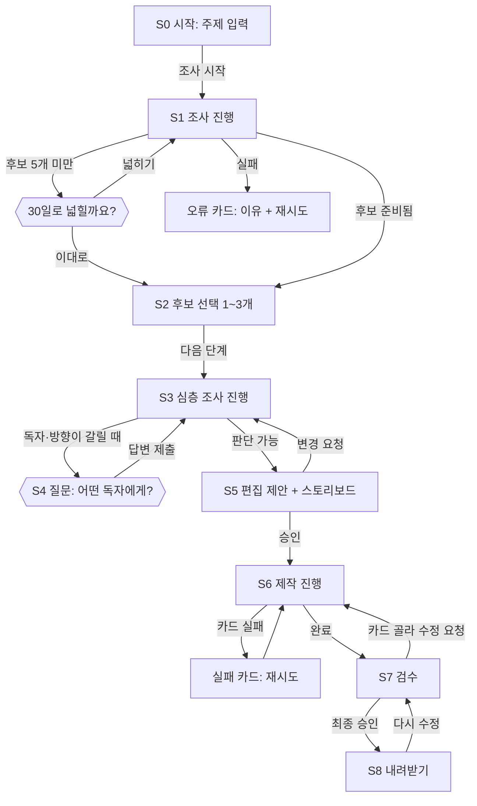

# 화면 흐름 (초안 v0.1)

> 상태: **검토 중** — 사용자가 승인하기 전까지 구현하지 않아요.
> API 이름과 상태 값은 API_SPEC.md를 따라요. AI가 임의로 정한 것에는 **[AI 기본안]**을 붙였어요.

## 전체 흐름



## 공통 화면 규칙

- **한 페이지 앱**이에요. 주소는 `/`(시작)와 `/p/{projectId}`(프로젝트) 두 개예요. 프로젝트 화면은 `stage`에 따라 해당 단계 영역을 보여 줘요.
- **새로고침해도 그대로**예요. 화면은 자기 상태를 갖지 않고 항상 `GET /api/projects/{id}` 응답으로 다시 그려요. 체크 중인 후보, 열린 질문, 진행 중 작업이 다시 보여요.
- **위쪽 고정 띠** — 주제 · 조사 기준 시각 · 조사 기간 · 현재 단계 표시(단계 점 9개). 모의 엔진이면 노란 띠 "모의 데이터예요. 실제 검색 결과가 아니에요."를 항상 보여 줘요.
- **진행 중일 때** — 진행 메시지 목록(최근 5개), 경과 시간, **취소** 버튼. 1.5초마다 폴링하고, 대기·완료 상태면 폴링을 멈춰요.
- **버튼 중복 방지** — 누르는 순간 requestId를 만들고 버튼을 잠가요. 응답이 오면 풀어요. 네트워크가 끊겨 다시 보낼 때도 같은 requestId를 써요.
- **오래된 화면** — `VERSION_CONFLICT`·`QUESTION_STALE`이 오면 최신 상태를 다시 불러오고 "화면이 바뀌어서 새로 불러왔어요"를 잠깐 보여 줘요. 사용자 입력(자유 입력 글)은 지우지 않아요.
- **오류 카드** — 제목(무슨 일이 있었는지) · 한 줄 이유 · 다음 행동 버튼. 예:
  - `AUTH_REQUIRED`: "Claude CLI 로그인이 필요해요. 터미널에서 `claude`를 실행해 로그인한 뒤 다시 시도해 주세요." [다시 시도]
  - `SEARCH_FAILED`: "검색이 실패했어요." + 엔진이 알려 준 이유 [다시 시도]
  - `IMAGE_FAILED`: 해당 카드 칸에만 표시 [이 카드 다시 만들기]
  - `INTERRUPTED`: "서버가 다시 시작돼서 작업이 멈췄어요." [이어서 하기] [이 단계 처음부터]
  - `CANCELLED`: "취소했어요." [다시 시작]
- 성공한 척하지 않아요. 파일 검사를 통과하지 못한 카드는 미리보기 대신 실패 칸을 보여 줘요.

## S0. 시작

- 주제 입력칸(자리 표시 글: `AI 최신소식`), 조사 기간 선택(최근 7일 기본 / 30일), [조사 시작].
- 아래에 이전 프로젝트 목록: 주제 · 만든 시각 · 현재 단계 · 대기 중이면 "답변 기다리는 중" 배지.
- 페이지를 열 때 `GET /api/health` 결과를 작게 보여 줘요: Claude CLI ✓ / agy ✓ / 브라우저 렌더러 ✓ / 글꼴 ✓. 없는 항목은 설치 안내 링크.
- [조사 시작] → `POST /api/projects` → `POST /research` → `/p/{id}`로 이동.

## S1. 넓은 조사 진행

- "2026-10-23 12:30 기준, 최근 7일(10-16 ~ 10-23)" 문구를 크게 보여 줘요.
- 진행 메시지 예: "검색어 4개로 찾는 중", "같은 발표 기사 묶는 중".
- 후보가 5개 미만이면 S4와 같은 질문 상자: "최근 7일 결과가 3개뿐이에요. 30일로 넓힐까요?" [30일로 넓히기] [이대로 보기]

## S2. 후보 선택

- 후보 카드 목록(7~12개). 카드 하나에:
  - 분야 배지(모델·제품·연구·개발 도구…) · 상태 배지(**출시됨 / 발표만 됨 / 업체 주장**)
  - 제목, 두세 줄 요약
  - 게시일 · 사건 발생일. 모르면 회색 "날짜 미확인"
  - 출처 목록(공식·논문·언론·블로그 표시). 묶인 기사가 여러 개면 "같은 발표 기사 3개" 접기
  - "고를 만한 이유" / "불확실한 점" 두 줄
- 체크박스로 1~3개. 체크할 때마다 저장(`POST /selection`). 4번째는 막고 "최대 3개까지예요" 안내.
- 아래 고정 바: "2개 골랐어요" + [다음 단계] (0개면 비활성). 다음 단계 전에는 제작을 시작하지 않아요.
- [다시 조사] 버튼(작게): 같은 기간으로 새로 검색.

## S3. 심층 조사 진행 → 조사 기록

- 진행 중: 선택한 후보별로 "원문 확인 중 / 공식 자료 찾는 중 / 완료".
- 완료되면 후보마다 접을 수 있는 조사 기록:
  - **확인된 사실**(각 줄에 출처 링크) · **한계** · **서로 다른 내용** · **열지 못한 원문**
- 이 기록은 S5·S7에서도 옆 패널로 다시 열 수 있어요.

## S4. 질문 상자 (여러 단계에서 같은 모양)

```
┌───────────────────────────────────────────┐
│ 어떤 독자에게 전달할까요?                    │
│                                           │
│ ○ 일반 사용자  용어 설명을 늘리고 생활 속 쓰임 중심 │
│ ○ 개발자  ⭐추천  API·도구 변화와 바로 해 볼 일 │
│ ○ 교육자  수업에 쓸 사례와 주의점 중심         │
│ ○ 직접 입력 [                          ]   │
│                                           │
│ 추천 이유: 선택한 두 소식이 모두 개발 도구라서요. │
│                              [답변 보내기]  │
└───────────────────────────────────────────┘
```

- 추천은 ⭐ 표시만 하고 **미리 선택하지 않아요.** 아무것도 고르지 않으면 [답변 보내기]가 비활성이에요.
- 보낸 뒤에는 상자가 "답변: 개발자 (12:41)"로 바뀌고 진행 화면으로 넘어가요.
- 모든 단계를 질문으로 만들지 않아요. 질문 없이 진행했으면 S5에 "AI가 이렇게 판단했어요 — 이유"를 보여 줘요.

## S5. 편집 제안 + 스토리보드 승인

- 위: 편집 제안 — 독자 · 독자에게 유용한 이유 · 카드 형식 · 후킹 문구 2~3개(각 문구 옆에 근거 사실 링크).
- 아래: 스토리보드 표(5~8장)

| 장 | 역할 | 제목 | 핵심 문장 | 근거 | 그림 계획 |
|---|---|---|---|---|---|
| 1 | 표지 | … | … | 링크 | 생성 / 위쪽 비움 |

- 근거가 비어 있는 카드는 빨간 표시 **[AI 기본안]**: 승인 전에 눈에 띄게.
- 버튼: [이대로 승인하고 제작] / [변경 요청] (글 입력 → `storyboard/feedback`). 승인 전에는 이미지를 만들지 않아요.

## S6. 제작 진행

- 카드 칸 5~8개를 격자로. 칸마다 상태: 대기 → 이미지 만드는 중 → 글자 넣는 중 → 완료(썸네일) / 실패(이유 + [이 카드 다시 만들기]).
- 한 카드가 실패해도 다른 카드는 계속 진행해요.
- 전부 끝나면 자동으로 S7로.

## S7. 검수와 부분 수정

- **전체 보기**: 카드 격자. **하나 보기**: 클릭하면 크게(1080×1350 원본)와 휴대폰 크기(가로 360px)를 나란히.
- 카드마다 점검 결과 두 줄을 따로:
  - 사실·출처: 통과 / 주의 / 실패 + 항목(예: "‘출시’라고 썼지만 조사 기록은 ‘발표만 됨’")
  - 글자·가독성: 잘림 없음 · 최소 글자 크기 · 대비 · 실제 크기 1080×1350
- 이미지 정보: "생성 이미지 (agy, 2026-10-23)" 또는 스톡 출처·라이선스. 실제 사진으로 오해할 만하면 카드 안에도 작은 "생성 이미지" 표기.
- 부분 수정: 카드 체크(여러 장 가능) → 수정 지시 입력 → [선택한 카드만 수정]. 체크하지 않은 카드는 그대로예요. 카드에 "v2" 같은 버전 표시, 이전 버전 보기 **[AI 기본안]**.
- 수정 요청하면 최종 승인이 풀린다는 안내를 버튼 옆에 적어요.
- [최종 승인]: 모든 카드가 완료일 때만 활성.
- **구현됨 (D18, 2026-10-23):** 카드 격자 + 점검 배지(통과·주의·실패) → 카드를 누르면 원본(축소)과 가로 360px 휴대폰 틀을 나란히, 점검에 걸린 글자 자리는 빨간 테두리. 자동으로 고친 내용과 수치(가장 작은 글자·대비·얼룩짐·크기)를 보여 줘요. 조정 칸: 글자 위치·크기·글자 뒤 배경·글자 색, 제목·핵심·본문 문구 → [이 카드에 적용]. 화면 너비 600px 이하에서는 원본을 숨기고 휴대폰 틀만 보여요. 사실·출처 점검·글로 하는 부분 수정·최종 승인은 다음 단계예요.

## S8. 내려받기

- "v3를 2026-10-23 13:05에 최종 승인했어요."
- 목록: 카드별 PNG(각각 내려받기) · 전체 ZIP · 출처 기록(`sources.md`) · 이미지 사용 기록(`image-credits.md`).
- 목록은 실제 파일 검사를 통과한 것만 보여 줘요.
- [다시 수정하기] → S7 (승인 해제).

## 화면 먼저 만들 때 (PRD 구현 순서 2)

`MockEngine`으로 S0 → S1 → S2 → S4(독자 질문) → S5까지 먼저 움직여요. 모의 후보 8개, 독자 질문 1개, 스토리보드 6장을 고정 데이터로 주고 노란 "모의 데이터" 띠를 보여 줘요. 이 단계에서 새로고침 유지, 버튼 두 번 누르기, 오래된 질문 답변 거절, 프로젝트 두 개 동시 진행을 먼저 확인해요.

## 검토할 때 봐 주실 곳

1. 단계를 한 페이지에서 바꿔 보여 주는 방식(단계별 주소를 따로 두지 않음).
2. 질문 상자를 S1(기간 확장)·S3(독자)에서 같은 모양으로 쓰는 것.
3. S7에서 이전 버전 보기까지 넣을지(빼면 구현이 줄어요).
4. 근거 없는 스토리보드 카드를 빨간색으로만 표시할지, 아예 승인을 막을지.
